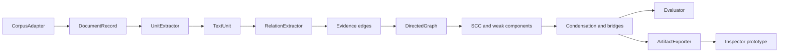

# ThemeGraph: Dataset-Independent Directed Evidence Graphs for Auditable Computational Sensemaking

Status date: 2026-08-24

Evidence labels used in this report:

- **Measured**: reproduced by code in this repository.
- **Verified**: checked against an authoritative external record.
- **Interpretation**: a reasoned reading of evidence, not a measured fact.
- **Proposal**: future work with an acceptance test.
- **Unresolved**: author action or external confirmation is required.

## 1. Executive Decision

**Decision: pivot.** Do not submit a paper whose claim is that Tarjan's algorithm discovers themes. Tarjan's strongly connected component algorithm is established prior art, and the current relation does not operationalize a qualitative theme. Instead, develop and evaluate **ThemeGraph as an auditable falsification framework for directed textual graph representations**.

The implemented system is a substantial repair of the notebook. It provides dataset adapters, deterministic text units, evidence-bearing directed edges, complete graph construction, iterative SCC extraction, condensation, bridge indicators, baselines, tests, exports, and an inspectable prototype. Eleven tests pass, including exact SCC agreement with NetworkX on seeded generated graphs.

The current results do not justify a strong SCC-centered contribution:

- The synthetic planted benchmark is recovered perfectly, but k-means, agglomerative clustering, and spectral clustering also reach ARI 1.0 and pairwise F1 1.0 on the same nine labeled terms.
- Real-corpus graphs differ from weak components, but edge and SCC structure varies with thresholds. Largest SCC size ranges from 11 to 20 for job ads, 3 to 10 for O*NET, and 9 to 16 for the ACM corpus.
- Conditional confidence is asymmetric, but lift is symmetric. Direction is therefore induced largely by term prevalence and thresholding, not a semantic relation such as enables, constrains, or precedes.
- The job advertisement source, sampling frame, dates, and redistribution license are unresolved. Its `Description` and `Skills` fields are exactly equal in 90.39 percent of records.

**Current CHI 2027 venue fit: conditional, leaning weak.** The auditability and uncertainty design problem is relevant to HCI, but the present evidence supports computational behavior, not usefulness to analysts. Proceed toward CHI only if the relation-validity, robustness, and HCI contribution gates in Sections 16 and 22 pass by 2026-08-31. Otherwise target a computational text analysis, visualization, or research-software venue and reserve a later CHI submission for work with stronger evidence about analyst activity.

## 2. Scope, Constraints, and Evidence Standard

This project does not recruit participants, collect new human-subject data, conduct expert ratings, or claim user benefit. It evaluates graph correctness, structural behavior, provenance, traceability, sensitivity, baseline agreement, cross-domain execution, runtime, and memory.

The term **structural candidate** is used for SCC outputs. The terms **theme** and **thematic analysis** are reserved for claims supported by a defensible interpretive method. Braun and Clarke describe thematic analysis as a method for identifying and interpreting patterned meaning, and their reflexive account rejects mechanical quality criteria detached from theoretical assumptions (Braun and Clarke 2006, 2021). A cycle in a term graph is not sufficient evidence of patterned meaning.

The evidence standard is adversarial:

1. Every technical claim must be executable or derived from an explicit definition.
2. Every dataset claim must state provenance and license status.
3. Every paper claim must have a baseline, metric, and stop condition.
4. Null results and tied baselines remain visible.
5. No computational metric is treated as evidence of human usefulness.
6. No employer, worker, applicant, or occupation is ranked or profiled.
7. The focal workbook is not redistributed while permission is unresolved.

## 3. Verified ACM CHI 2027 Requirements and Theme Fit

The official CHI 2027 site identifies the conference theme as **bridges** and describes connections across disciplines, research and practice, technical innovation and human values, and communities and systems. The conference is scheduled for May 10 to 14, 2027, in Pittsburgh. The papers deadline displayed by the official site is September 10, 2026, Anywhere on Earth.

The papers page states that submissions are judged on originality, significance, validity, research quality, and presentation clarity. It encourages approximately 5,000 to 8,000 words, treats submissions under 5,000 words as short papers, and warns that unjustified submissions above 12,000 words will be desk rejected. Review submissions use the required single-column format and must be anonymized, including linked code, data, media, and supplementary material. The main paper must stand alone.

Theme fit is secondary to contribution fit. ThemeGraph can speak to bridges between aggregate structures and source passages, but this wording cannot substitute for evidence. A defensible fit argument is:

- **HCI problem**: computational text-analysis interfaces often make derived structures easier to see than to question.
- **Interaction object**: an evidence graph whose thresholds, direction, baselines, and provenance remain inspectable.
- **Knowledge contribution**: design and evaluation requirements for falsifiable machine-proposed structures, including visible consequences of removing direction.
- **Limit**: no claim is made that the prototype improves analysis, trust calibration, or decision quality.

Official sources and access dates are recorded in Section 25.

## 4. Reproducible Codebase Audit

### Original notebook findings

| Severity | Finding | Consequence | Implemented repair |
| --- | --- | --- | --- |
| Critical | Co-occurrence and similarity edges are often inserted in both directions | SCCs collapse to connected components, making direction uninformative | One explicit asymmetric relation and a symmetrized baseline |
| Critical | SCCs are called themes without a construct definition | Structural output is mistaken for qualitative interpretation | Outputs are named structural candidates |
| High | Random DAG evaluation omits isolated nodes and reports fewer SCCs than nominal nodes | Correctness and coverage are overstated | Graph constructor accepts a complete node set |
| High | DAG timing experiments are presented near thematic examples | A DAG can only yield singleton SCCs | Canonical DAG invariant test |
| High | Weights such as 0.3, 0.5, and 0.2 have no derivation | Results depend on arbitrary scoring | Removed weighted composite score |
| High | Definitions and model loads are repeated across cells | Hidden state and divergent behavior | Modular `src/themegraph` package |
| High | Saved outputs are not evidence of fresh execution | Reproducibility is unclear | CLI, scripts, JSON artifacts, and tests |
| Medium | Recursive SCC code can exceed Python recursion depth | Large sparse graphs can fail | Iterative Tarjan implementation |
| Medium | Hard-coded paragraphs and domain terms appear in examples | Dataset independence is not demonstrated | Generic records and adapters |

### Implemented modules

| Path | Responsibility |
| --- | --- |
| `src/themegraph/models.py` | Typed document, unit, edge, evidence, and result records |
| `src/themegraph/adapters.py` | Iterable, directory, JSONL, delimited, XLSX, and O*NET ZIP adapters |
| `src/themegraph/text.py` | Deterministic sentence and lexical unit extraction |
| `src/themegraph/relations.py` | Conditional-association relation with evidence |
| `src/themegraph/graph.py` | Complete directed graph, SCCs, weak components, condensation, bridges |
| `src/themegraph/pipeline.py` | Orchestration and JSON-safe export |
| `src/themegraph/evaluation.py` | Structural metrics, ablations, communities, clustering, partition scores |
| `src/themegraph/audit.py` | Full workbook audit |
| `src/themegraph/synthetic.py` | Seeded planted-cycle benchmark |
| `src/themegraph/cli.py` | Reproducible command line entry point |
| `scripts/run_research_evaluation.py` | Five-corpus evaluation and threshold sweep |
| `prototype/` | Static inspectable research interface |

### Correctness evidence

- Eleven tests pass.
- Generated directed graphs for node counts 1 through 30 match `networkx.strongly_connected_components` exactly with seed 2027.
- A 5,001-node path completes without recursion failure.
- Isolated and destination-only nodes are preserved.
- Every component in a DAG fixture is a singleton.
- Reciprocal edges make SCC and weak-component partitions equal.
- Condensation is acyclic and preserves component membership.
- O*NET occupations and tasks join by O*NET-SOC code in an in-memory ZIP fixture.

Remaining test gaps include self-loop-specific assertions, duplicate-edge assertions, malformed archive errors, property-based tests, and golden JSON schema validation.

## 5. Electrical Engineering Dataset Audit and Dataset Card

### Measured dataset card

| Field | Value |
| --- | --- |
| Local source | `electrical_engineering_job_ads_data.xlsx` |
| Sheets | One worksheet |
| Records | 23,377, excluding header |
| Columns | Job Title, Company Name, Location, Description, Skills |
| Missing Company Name | 229, 0.98 percent |
| Missing Location | 3, 0.013 percent |
| Missing Description | 1, 0.004 percent |
| Missing Skills | 1,574, 6.73 percent |
| Exact duplicate row instances | 2 |
| Exact duplicate description instances | 2,810 |
| Unique descriptions | 20,567 |
| `Description == Skills` | 21,131, 90.39 percent |
| Median description length | 3,920 characters |
| 95th percentile description length | 7,986 characters |
| Maximum description length | 32,493 characters |
| Provenance | Unverified |
| Collection period and sampling frame | Unresolved |
| Redistribution permission | Unverified |

Whitespace normalization would change 6,512 descriptions, 6,506 skills fields, 6,682 company names, and 6,682 locations. The adapter strips surrounding whitespace for analysis but leaves the source workbook unchanged.

### Intended and prohibited use

**Intended use**: a stress case for text duplication, boilerplate, heterogeneous technical and organizational language, and provenance limitations.

**Prohibited use**: labor-market prevalence, hiring trends, employer quality, applicant suitability, skill demand, occupational representation, geographic comparison, or individual inference.

The corpus is not demonstrably representative of electrical engineering employment. Company names and locations can create reputational and anonymization risks. Raw text must remain local until provenance, terms, and redistribution rights are documented. The anonymous artifact should include the adapter, audit code, synthetic data, and non-identifying aggregate statistics, not the workbook.

## 6. HCI Problem Formulation

The target activity is not automated thematic analysis. It is **auditing a machine-proposed representation while moving between aggregate structure and source evidence**.

Potential interactors are computational social scientists, qualitative researchers using machine assistance, corpus analysts, and research-software auditors. Their hypothesized activity system includes selecting a corpus, configuring a relation, inspecting structural candidates, comparing alternatives, tracing edges to passages, documenting uncertainty, and deciding whether a representation should be rejected. These roles and tasks are design assumptions, not observed user facts.

The HCI problem has four parts:

1. **Representation opacity**: a graph can look explanatory while hiding extraction choices.
2. **Aggregation distance**: a component may be several transformations away from source text.
3. **parameter fragility**: thresholds can alter visible structure without making consequences legible.
4. **automation bias**: labels such as theme can confer unwarranted interpretive authority.

The prototype responds with overview plus details on demand, evidence excerpts, live threshold consequences, baseline comparison, provenance exports, and persistent unsupported-claim warnings. These are theory-derived design requirements. Their usability and benefit remain unevaluated.

## 7. Classical and Contemporary Literature Synthesis

### Qualitative interpretation

Braun and Clarke (2006) established thematic analysis as a method for identifying and interpreting patterned meaning. Their later account emphasizes theoretical coherence and reflexive quality practice rather than universal procedural criteria (Braun and Clarke 2021). ThemeGraph therefore cannot validate themes by cluster agreement alone.

Nelson's computational grounded theory combines computational pattern detection with human interpretive refinement and confirmation (Nelson 2020). It is closer to the defensible role of this artifact than automated theme generation: computation proposes patterns, but interpretation remains an accountable scholarly act.

### Sensemaking and external representation

Russell et al. (1993) model sensemaking in terms of the cost structure of searching for and encoding representations. Pirolli and Card (1999) explain information-seeking behavior through information foraging. These works motivate reducing the cost of moving between graph overview and evidence, but they do not prove the current interface succeeds.

Shneiderman's overview, zoom and filter, then details-on-demand formulation motivates corpus overview, filtering, and edge evidence (Shneiderman 1996). Horvitz's mixed-initiative principles motivate user control, uncertainty visibility, and interruptible automation (Horvitz 1999).

Hutchins (1995) treats cognition as distributed across people and representational media. Star and Griesemer (1989) show how boundary objects can support coordination across social worlds. These theories justify studying the graph as a mediating representation, not calling graph bridge scores evidence of social bridging.

### Computational text and graph methods

Chuang et al. (2012) studied interpretation and trust in model-driven visualizations for text analysis, placing ThemeGraph in an established HCI lineage. Blei et al. (2003) established latent Dirichlet allocation; Chang et al. (2009) demonstrated that likelihood and human interpretability can diverge. This warns against using internal graph metrics as semantic validation.

Tarjan (1972) gives a linear-time SCC algorithm. Newman and Girvan (2004) formalize community detection; Traag et al. (2019) show that Louvain can yield badly connected communities and introduce Leiden. SCCs, weak components, modularity communities, and vector clustering answer different structural questions and must not be compared as interchangeable theme algorithms.

Besta et al. (2024) use the name Graph of Thoughts for LLM reasoning graphs. ThemeGraph concerns evidence graphs over corpus terms and must avoid implying affiliation or methodological identity.

## 8. Prior-Art and Novelty Matrix

| Work | Problem and data | Representation or method | Human role | Relation to ThemeGraph |
| --- | --- | --- | --- | --- |
| Tarjan 1972 | Directed graph decomposition | Linear-time SCCs | None specified | Core algorithm is prior art |
| Braun and Clarke 2006, 2021 | Qualitative patterned meaning | Reflexive thematic analysis | Constitutive interpreter | Prevents automated-theme overclaim |
| Russell et al. 1993 | Sensemaking cost | Search and representation operations | Active sensemaker | Motivates inspectable transformations |
| Shneiderman 1996 | Information visualization tasks | Overview, filter, details | Interactive explorer | Direct interface precedent |
| Horvitz 1999 | Human-computer initiative | Mixed-initiative principles | Controls and corrects system | Motivates uncertainty and control |
| Chuang et al. 2012 | Topic model interpretation and trust | Model-driven text visualization | Interprets and evaluates topics | Closest HCI system lineage |
| Nelson 2020 | Interpretive text analysis at scale | Computational grounded theory | Refines and confirms patterns | Rejects fully automated interpretation |
| Traag et al. 2019 | Community quality | Leiden communities | None specified | Strong graph baseline and caution |
| Besta et al. 2024 | LLM problem solving | Arbitrary graph of LLM thoughts | Prompt designer and model user | Name collision, different problem |

### Novelty map

**Established components**: SCCs, condensation DAGs, co-occurrence statistics, confidence, lift, Louvain, modularity, k-means, agglomerative clustering, spectral clustering, overview-plus-detail, and evidence display.

**Established combination risk**: graph extraction plus SCC visualization is not sufficient novelty. Passage evidence and threshold controls are also common interaction patterns.

**Potential technical delta**: a reproducible test harness that evaluates whether a textual relation warrants directed cycle analysis, including global reversal invariance, symmetrization collapse, complete-node correctness, and traceability checks.

**Potential HCI knowledge delta**: design requirements for interfaces that make representational failure visible, especially when an apparently directed method derives direction from prevalence thresholds.

**Evidence still required**: machine-readable relation references, bootstrap uncertainty, perturbation tests, calibration, stronger corpora with defensible labels, and comparison to topic models. No current evidence supports analyst benefit.

## 9. Candidate Paper Directions and Decision Matrix

Scores range from 1, weak, to 5, strong. Ethical safety is scored higher when foreseeable risk is lower.

| Direction | HCI significance | Technical originality | Theory | Participant-free evaluation | Independence | Reproducibility | Ethical safety | Feasibility | Total |
| --- | ---: | ---: | ---: | ---: | ---: | ---: | ---: | ---: | ---: |
| 1. Typed directed graph with SCC cores | 3 | 2 | 3 | 3 | 5 | 5 | 4 | 3 | 28 |
| 2. Bridge-aware provenance interface | 4 | 2 | 4 | 2 | 5 | 5 | 4 | 3 | 29 |
| 3. Representation falsification framework | 4 | 3 | 4 | 5 | 5 | 5 | 5 | 4 | 35 |

**Selected direction: 3.** It matches the strongest available evidence, treats null results as contributions, and can be evaluated without participants. Direction 1 is weaker because the current edge semantics do not establish meaningful thematic cycles. Direction 2 has stronger interface relevance but would need evidence about analyst practice to support its central claims.

## 10. Selected Paper Thesis

For computational text systems that present directed graph structures as aids to sensemaking, direction and cycles should be treated as falsifiable representational commitments. A dataset-independent pipeline can expose those commitments by preserving source evidence, comparing SCCs against weak, symmetrized, community, and clustering baselines, and making parameter consequences inspectable. The contribution is not automatic thematic interpretation, but a method and artifact for determining when a directed structural account is unsupported.

Proposed contributions, limited to four:

1. A formal audit protocol for directed textual relations and SCC claims.
2. A dataset-independent, evidence-preserving reference implementation.
3. A multi-corpus benchmark with correctness, ablation, sensitivity, and baseline results, including negative findings.
4. An inspectable prototype that embodies falsifiability requirements without claiming demonstrated usability.

## 11. Proposed Title, Abstract, and One-Sentence Contribution Claim

### Proposed title

> When Do Directed Text Graphs Deserve Their Arrows? An Auditable Falsification Framework for Computational Sensemaking

### Draft abstract

Computational text-analysis systems often present graph structures as explanatory views, yet the direction, cycles, and labels in those graphs can depend on opaque extraction and threshold choices. We introduce ThemeGraph, a dataset-independent framework for constructing and auditing evidence-bearing directed text graphs. ThemeGraph separates corpus adapters, text units, relation extraction, graph algorithms, evaluation, and visualization; preserves passage-level evidence for each relation; and compares strongly connected components against weak components, symmetrization, no-relation, community-detection, and vector-clustering baselines. An iterative Tarjan implementation matches NetworkX on seeded graph fixtures and preserves isolated nodes. Across synthetic text, 2,000 electrical-engineering job advertisements, 500 O*NET occupations, ACM template files, and Python standard-library files, direction changes structural partitions, but real-corpus component sizes remain threshold-sensitive. On planted synthetic groups, SCCs achieve perfect agreement, but k-means, agglomerative, and spectral baselines also achieve perfect agreement, falsifying a superiority claim. We contribute an audit protocol, reference implementation, multi-corpus negative and positive evidence, and an inspectable prototype that exposes threshold consequences and source passages. We make no claim that graph components are validated themes or that the interface benefits analysts. The results show how falsifiability and provenance can discipline directed representations before they are used in human-facing sensemaking tools.

### One-sentence claim

ThemeGraph operationalizes directed-text-graph falsifiability by linking every retained relation to evidence and forcing SCC claims to survive explicit direction, threshold, and baseline tests.

## 12. Research Questions and Falsifiable Hypotheses

| ID | Question | Hypothesis | Current status |
| --- | --- | --- | --- |
| RQ1 | Is the SCC implementation correct and complete? | H1: partitions exactly match NetworkX and include every declared node | Supported on current fixtures |
| RQ2 | Does direction alter structure beyond weak connectivity? | H2: SCC and weak partitions differ on asymmetric corpora | Supported structurally, semantics unresolved |
| RQ3 | Does SCC recover planted groups better than clustering baselines? | H3: SCC ARI exceeds all same-representation baselines by at least 0.10 | Falsified, all tested methods have ARI 1.0 |
| RQ4 | Are outputs traceable? | H4: every retained default edge exposes at least one source excerpt and stable IDs | Supported by implementation, add exhaustive test |
| RQ5 | Are real-corpus conclusions threshold-stable? | H5: largest SCC varies by no more than 20 percent across the prespecified grid | Falsified for job ads, O*NET, and ACM |
| RQ6 | Is the direction semantically valid? | H6: asymmetric edges match machine-readable prerequisite, entailment, or hierarchy references with precision at least 0.80 | Not tested |
| RQ7 | Does the prototype improve human analysis? | No hypothesis in this participant-free study | Out of scope |

## 13. Formal Algorithm and Design Rationale

Let a corpus contain documents `D`. A deterministic unit extractor produces units `U`. Each unit `u` has a set of terms `T_u`. Let `N = |U|`, `n(a)` be the number of units containing term `a`, and `n(a,b)` the number containing both terms.

For ordered terms `(a,b)` define:

```text
confidence(a -> b) = n(a,b) / n(a)
prevalence(b)      = n(b) / N
lift(a -> b)       = confidence(a -> b) / prevalence(b)
                    = n(a,b) * N / (n(a) * n(b))
```

An edge `a -> b` is retained when:

```text
n(a)   >= minimum term support
n(a,b) >= minimum pair support
confidence(a -> b) >= confidence threshold
lift(a -> b)       >= lift threshold
```

The graph is `G = (V,E)`, where `V` includes every retained vocabulary term, including isolated and destination-only nodes. Each edge stores relation type, confidence, lift, support, unit IDs, document IDs, and excerpts.

Important consequence: `lift(a -> b) = lift(b -> a)`. Lift filters association strength but contributes no direction. Direction comes from unequal conditional confidence, often because `n(a) != n(b)`. This is an association direction, not necessarily a semantic or causal direction.

### Pseudocode

```text
INPUT: documents, unit extractor, relation configuration

units <- extract_units(documents)
term_counts <- empty counter
pair_counts <- empty counter
evidence <- empty bounded evidence map

for each unit in units:
    terms <- unique terms in unit
    increment term_counts for each term
    increment pair_counts for each unordered term pair
    retain stable evidence IDs and excerpt for each pair

V <- terms satisfying vocabulary and support rules
E <- empty list
for each observed pair {a,b} in V:
    for each ordered direction (a,b), (b,a):
        compute confidence, prevalence, and lift
        if all thresholds pass:
            append typed edge with evidence to E

G <- complete directed graph from V and E
S <- iterative_tarjan_scc(G)
W <- weak_components(G)
C <- condensation_dag(G, S)
B <- cross-component bridge indicators(G, S)

return V, E, S, W, C, B, configuration, provenance
```

### Invariants

1. Every declared node belongs to exactly one SCC.
2. The condensation graph is acyclic.
3. Every SCC in a DAG is a singleton.
4. Global edge reversal preserves the SCC partition.
5. Symmetrizing every edge makes SCCs equal weak components.
6. Default retained edges have bounded passage evidence.

### Complexity

Let `L` be input characters, `k_u = |T_u|`, `P` be observed term pairs, and `M` be retained evidence records.

- Unit extraction: `O(L)` for the current regex implementation.
- Pair counting: `O(sum_u k_u^2)` time and `O(P)` memory.
- Edge filtering: `O(P)` time.
- Tarjan SCC, weak components, and condensation: each `O(|V| + |E|)` time.
- Stored graph and evidence: `O(|V| + |E| + M)` memory.

The pair-counting stage, not Tarjan, is the likely scaling bottleneck. The 500-term vocabulary cap is an engineering bound, not a theoretically selected value.

### Failure cases

- Common terms receive incoming edges from rarer terms because of conditional confidence.
- Boilerplate creates high-support associations unrelated to an analytic construct.
- Similar-frequency co-occurring terms create reciprocal edges and cycles by threshold coincidence.
- Sentence segmentation errors alter support.
- Token normalization merges or fragments concepts.
- Vocabulary truncation excludes domain-specific terms.
- Thresholds fragment or merge structures.
- Evidence excerpts show co-occurrence, not semantic direction.

## 14. Dataset-Independent Software Architecture



The implemented core contains no job-ad field names, electrical-engineering vocabulary, spaCy model, or embedding dependency. Adapters map source-specific structures into `DocumentRecord`. The O*NET adapter streams the official text archive and joins descriptions and tasks by O*NET-SOC code.

Two boundaries remain intentionally incomplete:

- `ThemeCandidateGenerator` is not implemented because structural components are not validated themes.
- Semantic relation extractors are not implemented because no relation-specific gold evaluation has been completed.

Configuration is exported with every result. Randomized synthetic data and clustering use seed 2027. To run the research script from a source checkout, set `PYTHONPATH=src` or install the package in editable mode.

## 15. Multi-Dataset Evaluation Plan

### Completed corpus families

| Corpus | Documents | Units | Nodes | Edges | SCCs | Nontrivial | Largest SCC | Asymmetric edge rate |
| --- | ---: | ---: | ---: | ---: | ---: | ---: | ---: | ---: |
| Synthetic planted cycles | 90 | 90 | 13 | 27 | 7 | 3 | 3 | 0.333 |
| Job ads, first 2,000 | 2,000 | 28,041 | 500 | 309 | 483 | 3 | 16 | 0.469 |
| O*NET 30.3, first 500 | 500 | Not separately reported here | 500 | 213 | 485 | 7 | 8 | 0.784 |
| ACM template files | 18 | 12,879 | 500 | 740 | 422 | 48 | 10 | 0.624 |
| Python standard library files | 100 | 42,858 | 500 | 252 | 476 | 19 | 4 | 0.770 |

O*NET 30.3 is licensed CC BY 4.0 and is attributed to USDOL/ETA. The derived analysis joins occupation descriptions and task statements and clearly discloses this modification. Python source distribution licensing is documented by the Python Software Foundation. The ACM template corpus is a mechanics check, not a substantive text benchmark. The job-ad source remains unverified.

### Performance on this machine

| Corpus | Core wall time, seconds | Peak Python allocation, MiB |
| --- | ---: | ---: |
| Synthetic | 0.006 | 0.10 |
| Job ads | 9.048 | 188.91 |
| O*NET | 2.020 | 51.07 |
| ACM | 0.748 | 15.88 |
| Python | 2.730 | 55.03 |

These are single-run engineering observations on Python 3.12.13, not inferential performance estimates. Repeat runs, machine specifications, and scaling curves are required for publication.

### Required next datasets

At least one corpus must provide machine-readable directed relations, such as documented prerequisites, taxonomic parent-child edges, regulatory cross-references, or process precedence. At least one must provide defensible reference labels for partition metrics. Corpus selection must be based on license, provenance, construct fit, and non-participant ethics, not convenience.

## 16. Baselines, Ablations, Metrics, and Statistical Analysis

### Completed baselines and ablations

- Weak components and symmetrized connected components.
- No-SCC baseline with every node as a singleton.
- Global edge reversal, which correctly leaves SCC partitions unchanged.
- Greedy modularity and seeded Louvain communities.
- K-means, agglomerative, and spectral clustering using identical directed edge-profile features on the labeled synthetic benchmark.
- Removal of bridge scoring and condensation ordering, which leaves the core SCC partition unchanged by construction.
- Nine-setting grid: confidence in `{0.50, 0.65, 0.80}` and lift in `{1.00, 1.05, 1.25}`.

### Key baseline result

SCCs recover the three planted core groups with ARI 1.0 and pairwise precision, recall, and F1 of 1.0. K-means, agglomerative clustering, and spectral clustering also produce ARI and F1 of 1.0 on the same nine labeled terms. The benchmark validates implementation behavior but provides no evidence that SCC is superior.

Spectral clustering emits a warning that the affinity graph is not fully connected. This limitation must remain visible and should be addressed by component-wise spectral analysis or a connected benchmark, not suppressed.

### Threshold sensitivity

| Corpus | Edge range | Largest SCC range | Interpretation |
| --- | ---: | ---: | --- |
| Synthetic | 27 to 39 | 3 to 3 | Planted core size stable |
| Job ads | 190 to 488 | 11 to 20 | Material sensitivity |
| O*NET | 110 to 411 | 3 to 10 | High sensitivity |
| ACM | 627 to 1,514 | 9 to 16 | Material sensitivity |
| Python | 214 to 314 | 4 to 5 | More stable, small SCCs |

### Publication acceptance gates

| Dimension | Metric | Acceptance threshold | Stop condition |
| --- | --- | --- | --- |
| SCC correctness | Exact partition agreement | 100 percent over canonical and property-based fixtures | Any unexplained mismatch |
| Relation validity | Precision against directed reference | At least 0.80 with 95 percent interval lower bound above 0.70 | No suitable reference or lower precision |
| Traceability | Edges with stable evidence | 100 percent in default exports | Any untraceable edge |
| Threshold stability | Bootstrap co-membership and largest-SCC variation | Prespecified interval and variation below 20 percent | Findings reverse across plausible settings |
| Added value | SCC versus simpler baseline | At least 0.10 ARI or prespecified structural gain on two labeled corpora | Ties across all defensible tasks |
| Cross-domain behavior | Same configuration without domain code | At least four domains, failures reported | Domain-specific core changes required |
| Efficiency | Scaling model and repeated timing | Near-linear graph stage, bounded memory reported | Pair stage is infeasible at target scale |

### Proposed statistical analysis

1. Bootstrap documents within each corpus at least 1,000 times.
2. Report edge-selection probability, pairwise SCC co-membership probability, and confidence intervals.
3. Apply controlled synonym, sentence-order, and boilerplate perturbations.
4. Compare effect sizes, not only significance tests.
5. Correct families of threshold comparisons with Holm's method.
6. Report calibration curves for confidence against directed references.
7. Separate exploratory threshold selection from held-out confirmation.

LDA, BERTopic, HDBSCAN, and embedding baselines are not yet implemented. They should be added only with a shared unit of analysis and defensible cluster-count or density configuration. An unfair baseline catalog would add volume without evidence.

## 17. Research Prototype and Interaction Design

The static prototype is available in `prototype/` and reads full evidence-bearing JSON exports. It currently supports:

- Corpus switching across five generated analyses.
- Live confidence and lift thresholds.
- Relation-type filtering and text search.
- Browser-side SCC and condensation recomputation.
- Up to 32 largest components in an accessible SVG overview.
- Keyboard-operable component selection.
- Evidence excerpts with document and unit IDs.
- SCC, weak or symmetrized, and no-SCC comparison.
- Filtered graph and reproducibility-manifest export.
- Persistent warning that outputs are structural candidates.
- Shape, text, and color-redundant graph encoding.
- Responsive layouts at desktop and 390 px mobile width.

Browser validation found no console errors or horizontal overflow. Switching to O*NET loaded 500 documents; increasing confidence from 0.65 to 0.80 reduced visible edges from 213 to 110 and recomputed 496 SCCs.

### Theory-to-design mapping

| Requirement | Design response | Evidence status |
| --- | --- | --- |
| Overview plus detail | SCC list, condensation view, evidence panel | Implemented |
| Mixed initiative | User-controlled thresholds and filters | Implemented, benefit untested |
| Traceability | Stable IDs and excerpts on edges | Implemented |
| Falsifiability | Side-by-side structural baselines | Implemented for three views |
| Uncertainty | Warning and live structural consequences | Partial, no confidence intervals yet |
| Accessibility | Keyboard nodes, labels, non-color distinctions | Browser checked, formal audit pending |

No claim is made about usability, learnability, trust, sensemaking quality, or analyst performance.

## 18. Ethical, Legal, and Societal Considerations

No new human-subject data is collected. Secondary data can still create ethical and legal obligations. The authors must seek the appropriate local determination about whether institutional review is needed; this report makes no universal legal claim.

Primary risks are:

- **Reputational harm**: employer text could be interpreted as employer ranking or intent.
- **Occupational stereotyping**: frequent language could be presented as what engineers should be.
- **Automation bias**: graph components may be treated as authoritative themes.
- **Privacy and contextual integrity**: public-facing text can still be repurposed outside expected context.
- **License violation**: the workbook's redistribution rights are unknown.
- **English and geographic bias**: tokenization and corpora are English-focused and geographically unclear.
- **Environmental cost**: the current lexical pipeline is light, but future embedding baselines must report hardware, energy-relevant runtime, and model reuse.

Mitigations include local-only workbook loading, aggregate reporting, no company rankings, no protected-attribute inference, explicit warnings, provenance fields, evidence links, configuration export, and stop conditions. O*NET attribution must name O*NET 30.3 Database and USDOL/ETA, link CC BY 4.0, disclose modifications, and state that USDOL/ETA has not endorsed them.

ACM policy treats AI systems as tools, not authors. The authors must disclose generative-AI use according to the policy current at submission and take responsibility for text, code, citations, and claims.

## 19. Threats to Validity and Failure Conditions

| Threat | Consequence | Mitigation | Reject or stop when |
| --- | --- | --- | --- |
| Construct validity | SCC is mistaken for theme | Use structural-candidate language and directed references | No operational relation construct is defensible |
| Internal validity | Thresholds create desired cycles | Prespecify grid, bootstrap, held-out confirmation | Conclusions depend on one setting |
| Baseline validity | Easier or mismatched baselines exaggerate value | Same units and features where possible | Simple methods tie or win everywhere |
| Corpus validity | Job ads lack sampling provenance | Treat as stress case only | Paper needs labor-market claims |
| External validity | Five corpora are narrow and English-heavy | Add licensed domains with reference structure | Core code requires domain-specific changes |
| Measurement validity | Co-occurrence evidence is treated as direction evidence | Evaluate against directed gold relations | Precision is below threshold |
| Reproducibility | Local paths or unpinned dependencies leak | Lock environment and test clean checkout | Clean artifact run fails |
| Interface validity | Theory-derived requirements are presented as user needs | Avoid benefit claims | Paper requires usability conclusions |
| Novelty | Known methods are packaged as algorithmic novelty | Frame protocol, evidence, and negative results | Closest work already provides same tested delta |

The strongest current failure condition is semantic direction. If a directed reference task cannot distinguish the conditional-association edges from frequency artifacts, the SCC-centered representation should be removed from the central claim.

## 20. Reproducibility and Anonymous Artifact Plan

Release:

- Source package and tests.
- Synthetic generator and seed.
- O*NET download instructions, license, attribution, and transformation statement.
- Corpus adapters that expect local paths.
- Evaluation script and generated aggregate JSON where licensing permits.
- Static prototype.
- Environment lock with Python and dependency versions.
- Machine-readable configuration and result schema.
- Commands for tests, lint, audits, evaluation, and serving the prototype.

Do not release:

- The focal XLSX workbook.
- Raw employer passages or company-level outputs.
- Personal file paths, usernames, notebook metadata, or repository history that reveals identity.

Current environment: Python 3.12.13, NetworkX 3.6.1, scikit-learn 1.9.0, pytest 9.1.1, and Ruff 0.16.4. `joblib` 1.5.3 was force-reinstalled after an incomplete namespace package caused scikit-learn import failure.

Anonymous artifact acceptance test:

```text
1. Clone into a path without author identifiers.
2. Create a clean environment from the lock file.
3. Install the package in editable mode.
4. Run pytest and Ruff.
5. Generate synthetic and licensed-corpus results.
6. Serve prototype and load every corpus.
7. Scan files, metadata, URLs, and git history for identity leaks.
8. Scan authored artifacts for forbidden Unicode dash characters.
```

## 21. ACM CHI Paper Outline With Target Word Counts

| Section | Target words | Purpose |
| --- | ---: | --- |
| Abstract | 200 | Problem, framework, findings, limits |
| Introduction | 750 | HCI problem and falsification thesis |
| Related work | 1,000 | Interpretation, sensemaking, text visualization, graph methods |
| Directed representation audit | 650 | Formal commitments and failure modes |
| ThemeGraph method | 1,100 | Architecture, equations, evidence, complexity |
| Inspector artifact | 750 | Interaction rationale and accessibility |
| Evaluation | 1,500 | Fixtures, five corpora, baselines, ablations, uncertainty |
| Findings | 700 | Positive, negative, and sensitivity results |
| Discussion | 650 | HCI knowledge and venue boundaries |
| Ethics and limitations | 450 | Secondary-data risks and no-participant scope |
| Conclusion | 200 | Narrow contribution and next evidence |
| **Total** | **7,950** | Within the encouraged range |

Essential arguments, equations, baseline results, and limitations must remain in the paper rather than supplementary material.

## 22. Implementation Roadmap With Dependencies and Acceptance Tests

The deadline is close. A paper should not be submitted merely because a draft can be assembled.

| Date | Work | Dependency | Acceptance test |
| --- | --- | --- | --- |
| Aug 24 to 25 | Freeze current implementation and report | Current repository | Eleven tests and Ruff pass |
| Aug 25 to 27 | Add directed-reference corpus and edge evaluation | Licensed source with machine-readable relations | Precision gate in Section 16 |
| Aug 27 to 29 | Bootstrap, perturbation, and scaling analysis | Stable configuration | Confidence intervals and failure plots |
| Aug 29 to 30 | Add fair LDA and density or embedding baseline | Shared units and prespecified tuning | Reproducible baseline table |
| Aug 30 to 31 | Novelty and CHI gate review | Complete results | Proceed only if contribution survives |
| Sep 1 to 3 | Draft 7,000 to 8,000 word paper | Gate passed | Every claim linked to evidence |
| Sep 4 to 5 | Internal methods and HCI review | Full draft | No theme or benefit overclaim |
| Sep 5 to 6 | Accessibility and artifact audit | Stable prototype | Keyboard, contrast, captions, clean run |
| Sep 6 to 7 | Anonymization and policy review | Final files | No identity leaks, policy compliance |
| Sep 8 | Internal submission freeze | Complete package | PDF and supplement independently checked |
| Sep 9 | Contingency only | No new research features | Upload verification |
| Sep 10 AoE | Official deadline | All gates passed | Submit or consciously stop |

**Hard stop on Aug 31**: do not target CHI 2027 if directed relation validity is not established, simpler baselines remain tied without a distinct HCI finding, or the manuscript relies on untested user-benefit language.

## 23. Claim-to-Evidence Matrix

| Proposed claim | Dataset or artifact | Baseline | Metric | Required evidence | Current disposition |
| --- | --- | --- | --- | --- | --- |
| SCC implementation is correct | Canonical and seeded graphs | NetworkX | Exact partition | 100 percent | Supported on current suite |
| Complete graphs preserve all nodes | Isolates, paths, DAG | Nominal node set | Coverage | 100 percent | Supported |
| Direction changes structure | Five corpora | Weak and symmetrized | Partition equality, sizes | Difference on at least two corpora | Supported structurally |
| Direction encodes a meaningful relation | Directed-reference corpus | Frequency and co-occurrence | Precision, calibration | Section 16 gate | Unsupported |
| SCC adds value over clustering | Synthetic plus labeled real corpus | K-means, agglomerative, spectral, communities | ARI, F1 | At least 0.10 gain on two corpora | Falsified on synthetic, untested elsewhere |
| Results are robust | Every real corpus | Threshold, bootstrap, perturbations | Variation and co-membership | Prespecified stability | Current threshold evidence is negative |
| Results are traceable | Full JSON exports | No-evidence ablation | Edge evidence coverage | 100 percent | Implemented, exhaustive test needed |
| Framework is dataset-independent | Five adapters and corpora | Domain-specific variant | Core-code changes | None required | Supported for execution |
| Prototype is inspectable | Browser checks | Static output | Functional controls, errors, overflow | All required controls function | Supported mechanically |
| Prototype helps analysts | None | Appropriate interface baseline | Human-centered outcomes | Participant evidence | Not claimed |

## 24. Verified References

Besta, Maciej, Nils Blach, Ales Kubicek, Robert Gerstenberger, Michal Podstawski, Lukas Gianinazzi, Joanna Gajda, Tomasz Lehmann, Hubert Niewiadomski, Piotr Nyczyk, and Torsten Hoefler. 2024. "Graph of Thoughts: Solving Elaborate Problems with Large Language Models." *Proceedings of the AAAI Conference on Artificial Intelligence* 38(16): 17682-17690. [DOI](https://doi.org/10.1609/aaai.v38i16.29720)

Blei, David M., Andrew Y. Ng, and Michael I. Jordan. 2003. "Latent Dirichlet Allocation." *Journal of Machine Learning Research* 3: 993-1022. [JMLR](https://www.jmlr.org/papers/v3/blei03a.html)

Braun, Virginia, and Victoria Clarke. 2006. "Using Thematic Analysis in Psychology." *Qualitative Research in Psychology* 3(2): 77-101. [DOI](https://doi.org/10.1191/1478088706qp063oa)

Braun, Virginia, and Victoria Clarke. 2021. "One Size Fits All? What Counts as Quality Practice in (Reflexive) Thematic Analysis?" *Qualitative Research in Psychology* 18(3): 328-352. [DOI](https://doi.org/10.1080/14780887.2020.1769238)

Chang, Jonathan, Jordan Boyd-Graber, Sean Gerrish, Chong Wang, and David M. Blei. 2009. "Reading Tea Leaves: How Humans Interpret Topic Models." *Advances in Neural Information Processing Systems 22*. [NeurIPS record](https://proceedings.neurips.cc/paper/2009/hash/f92586a25bb3145facd64ab20fd554ff-Abstract.html)

Chuang, Jason, Daniel Ramage, Christopher Manning, and Jeffrey Heer. 2012. "Interpretation and Trust: Designing Model-Driven Visualizations for Text Analysis." *Proceedings of the SIGCHI Conference on Human Factors in Computing Systems*: 443-452. [DOI](https://doi.org/10.1145/2207676.2207738)

Horvitz, Eric. 1999. "Principles of Mixed-Initiative User Interfaces." *Proceedings of the SIGCHI Conference on Human Factors in Computing Systems*: 159-166. [DOI](https://doi.org/10.1145/302979.303030)

Hutchins, Edwin. 1995. *Cognition in the Wild*. MIT Press. [Publisher record](https://mitpress.mit.edu/9780262581462/cognition-in-the-wild/)

McInnes, Leland, John Healy, and Steve Astels. 2017. "hdbscan: Hierarchical Density Based Clustering." *Journal of Open Source Software* 2(11): 205. [DOI](https://doi.org/10.21105/joss.00205)

Nelson, Laura K. 2020. "Computational Grounded Theory: A Methodological Framework." *Sociological Methods & Research* 49(1): 3-42. [DOI](https://doi.org/10.1177/0049124117729703)

Newman, M. E. J., and M. Girvan. 2004. "Finding and Evaluating Community Structure in Networks." *Physical Review E* 69: 026113. [DOI](https://doi.org/10.1103/PhysRevE.69.026113)

Pirolli, Peter, and Stuart Card. 1999. "Information Foraging." *Psychological Review* 106(4): 643-675. [DOI](https://doi.org/10.1037/0033-295X.106.4.643)

Russell, Daniel M., Mark J. Stefik, Peter Pirolli, and Stuart K. Card. 1993. "The Cost Structure of Sensemaking." *Proceedings of the SIGCHI Conference on Human Factors in Computing Systems*: 269-276. [DOI](https://doi.org/10.1145/169059.169209)

Shneiderman, Ben. 1996. "The Eyes Have It: A Task by Data Type Taxonomy for Information Visualizations." *Proceedings 1996 IEEE Symposium on Visual Languages*: 336-343. [DOI](https://doi.org/10.1109/VL.1996.545307)

Star, Susan Leigh, and James R. Griesemer. 1989. "Institutional Ecology, 'Translations' and Boundary Objects: Amateurs and Professionals in Berkeley's Museum of Vertebrate Zoology, 1907-39." *Social Studies of Science* 19(3): 387-420. [DOI](https://doi.org/10.1177/030631289019003001)

Tarjan, Robert. 1972. "Depth-First Search and Linear Graph Algorithms." *SIAM Journal on Computing* 1(2): 146-160. [DOI](https://doi.org/10.1137/0201010)

Traag, V. A., L. Waltman, and N. J. van Eck. 2019. "From Louvain to Leiden: Guaranteeing Well-Connected Communities." *Scientific Reports* 9: 5233. [DOI](https://doi.org/10.1038/s41598-019-41695-z)

## 25. Evidence Ledger and Unresolved Questions

### Evidence ledger

| Claim | Source | Date | Stable record | Accessed | Support and status |
| --- | --- | --- | --- | --- | --- |
| CHI 2027 dates and bridges theme | ACM CHI 2027 | Current site | [Official site](https://chi2027.acm.org/) | 2026-08-24 | Official site, verified |
| Paper deadline, lengths, review and anonymity | ACM CHI 2027 Papers | Current site | [Submission details](https://chi2027.acm.org/authors/papers/#submission-details) | 2026-08-24 | Official author guidance, verified |
| Review criteria and transparency | CHI review and successful-submission pages | Current site | [Review process](https://chi2027.acm.org/authors/papers/papers-review-process/) | 2026-08-24 | Official guidance, verified |
| AI tools are not authors | ACM authorship policy | Current policy | [Authorship policy](https://www.acm.org/publications/policies/new-acm-policy-on-authorship) | 2026-08-24 | Official policy, verified |
| Human-participant policy exists | ACM publications policy | Current policy | [Human-participant policy](https://www.acm.org/publications/policies/research-involving-human-participants-and-subjects) | 2026-08-24 | Official policy, local determination unresolved |
| O*NET 30.3 license is CC BY 4.0 | O*NET Resource Center | 30.3 release | [O*NET license](https://www.onetcenter.org/license_db.html) | 2026-08-24 | Official license, verified |
| O*NET archive and schema | O*NET Resource Center | 30.3 release | [O*NET database](https://www.onetcenter.org/database.html) | 2026-08-24 | Official source and downloaded archive, verified |
| Python license terms | Python Software Foundation | Current documentation | [Python license](https://docs.python.org/3/license.html) | 2026-08-24 | Official documentation, verified |
| SCC algorithm and complexity | Tarjan 1972 | 1972 | [DOI](https://doi.org/10.1137/0201010) | 2026-08-24 | Crossref plus publisher metadata, verified |
| Thematic analysis is interpretive | Braun and Clarke | 2006, 2021 | DOI records in Section 24 | 2026-08-24 | Crossref plus publisher metadata, verified |
| Topic interpretation requires care | Chuang et al.; Chang et al. | 2012, 2009 | Stable records in Section 24 | 2026-08-24 | ACM and NeurIPS records, verified |
| Workbook quality statistics | Local full workbook audit | 2026-08-24 | `results/job_ads_audit.json` | 2026-08-24 | Full streaming audit, measured |
| Cross-corpus structural results | ThemeGraph evaluation | 2026-08-24 | `results/research_evaluation_summary.json` | 2026-08-24 | Reproduced locally, measured |
| Prototype browser behavior | Integrated browser and Playwright | 2026-08-24 | `prototype/` | 2026-08-24 | Desktop and mobile mechanics checked |

### Unresolved questions requiring author action

1. Who collected the job advertisements, from which platforms, under what terms, during what dates, and using what sampling method?
2. May the workbook or any raw excerpts be redistributed?
3. Does the institution require an IRB or non-human-subject determination for secondary public-facing employer text?
4. Which directed-reference corpus best matches a theoretically meaningful relation?
5. Can a semantic relation extractor meet the precision and calibration gate?
6. Does SCC add value on any labeled corpus after fair baseline tuning?
7. Which closest HCI systems already expose provenance, threshold sensitivity, and baseline disagreement together?
8. Can bootstrap and perturbation analysis produce stable findings before Aug 31?
9. Can the prototype pass a formal WCAG-oriented accessibility audit?
10. What exact generative-AI disclosure is required by ACM at the submission date?
11. Are ACM template files suitable for redistribution as analyzed outputs under their local license?
12. If CHI fit remains weak, which alternative venue best matches the final contribution and evidence?

The project should proceed as a rigorous research artifact. The CHI submission should proceed only if the unresolved relation-validity and contribution gates pass. Stopping or redirecting the paper is a valid research outcome.
